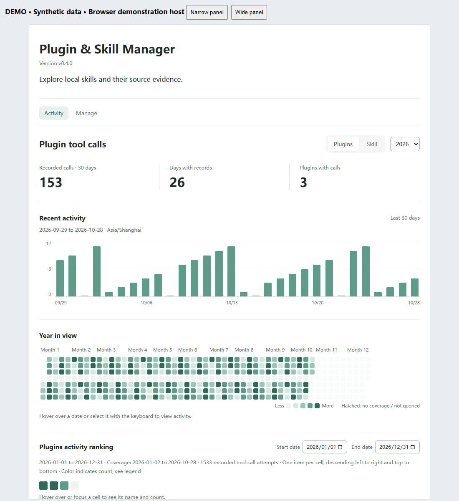

# Plugin & Skill Manager

Current release: **v0.4.1**. Upgrading from the old `codex-skill-manager` identity? See the [rename and upgrade notes](docs/IDENTIFIER_RENAME.md).

**New in v0.4.1:** Plugins and Skills share a compact filter/search layout. Inventory refresh uses the installed-plugin endpoint and keeps navigation/search usable while waiting; a local packaged MCP check took 1.891 seconds for 28 plugins and 67 Skill files. Activity separates **Host events** from **Assistant reports** and labels Skill adoptions as assistant-reported. [Changes, compatibility and verification](docs/releases/v0.4.1.md). Plugin/listing and sidebar icons now use the same orange-gold double wrench.

**New in v0.4.0:** Muted teal activity charts, recorded 30-day summaries and a daily bar chart linked to the annual calendar. Hover or focus to inspect a day; click a bar or square to pin named daily rankings, then choose **Back to all** to restore your date range. Only Activity and Manage remain.

Optional automatic local host-event capture from v0.3.3 remains available, with persisted opt-in/disable and a shared 5–3600 second interval. [Setup and privacy](docs/AUTO_CAPTURE.md).

**See which Skills were recorded as adopted, and which plugins were recorded as called.**

A local activity dashboard for Codex: calendar heatmaps, date-filtered rankings, and separate records for Skill adoptions and plugin call attempts.

**English** | [中文](README.zh-CN.md) · [Install](docs/DISTRIBUTION.md) · [Release v0.4.1](https://github.com/zz11ss11zz/plugin-skill-manager/releases/tag/v0.4.1) · [Apache-2.0](LICENSE)



*Actual v0.4.0 browser screenshot with synthetic records. Two-view navigation, daily bars, annual calendar and recorded summaries; this is not a native Codex screenshot. [Verification and reproduction](docs/releases/v0.4.0.md).*

## What it helps you do

- Compare recorded activity in the last 30 days and over a year. Bars and calendar squares share a selected date; pinned daily rankings list names and counts. Back to all restores the period filters.
- Switch between Skill adoptions and plugin tool-call attempts without mixing the metrics.
- Filter period rankings by date independently of the pinned day, and distinguish missing coverage from zero activity.
- Inspect low-use candidates and items with no records in a compact observation panel. Open the counting details when needed; nothing is archived automatically.
- Click Personal skills, System skills, Skills in plugin cache, or Total in Manage to browse that category, then search within it. Counts represent Skill files, not plugins.
- Plugin installation status is checked automatically when entering Manage, with a one-minute cache and a retry action on failure. Save notes and preview reversible Windows user-skill archives and restores in the same view.
- The separate Setup page has been removed. The companion setup Skill and read-only recording diagnostic tool remain available in chat.

The complete product combines a **local MCP service, an activity UI, and a companion Skill**. Installing the Skill alone does not install the service. Skill adoption recording requires caller participation. Plugin calls support opt-in local host-event capture since v0.3.3; without it, callers must report calls. Local logs do not establish complete host-wide coverage. Missing records do not mean a Skill was never used.

## Where it runs

**The current package targets local Codex use, including the Codex desktop app. It does not run directly in ChatGPT on the web.**

| Environment | Current project support |
| --- | --- |
| Codex desktop with a local executor | Intended UI host; Windows installation and MCP checks passed. Native sidebar interaction remains incompletely verified. |
| Codex CLI | Local installation, registration and MCP tools are tested; the CLI does not provide the graphical dashboard. |
| ChatGPT web / cloud execution | Not supported by this release. No hosted MCP endpoint or configured web bridge is included. |
| Other desktop hosts / operating systems | Not verified by this project. |

The service launches through local `stdio` using Node.js, reads local Codex files, and uses the Codex CLI for installed-plugin discovery. Signing in to the same account on the web does not connect these local resources. Browser screenshots and UI tests demonstrate the frontend, not a ChatGPT web deployment. Web support would require a supported remote connection or bridge plus explicit handling of local data access, authentication and permissions; changing the manifest alone is insufficient.

Platform references (checked 2026-10-29): [desktop-only plugins](https://developers.openai.com/plugins/deploy/desktop-only) and [MCP host/configuration boundaries](https://learn.chatgpt.com/docs/extend/mcp). These describe platform capabilities, not certification of this project.

## Quick start: complete manager

Tested on Windows. Requires Node.js 20.18+ and the Codex CLI on PATH. This is an independent project, not an official OpenAI product or an official-directory listing.

Download the [v0.4.1 complete plugin ZIP](https://github.com/zz11ss11zz/plugin-skill-manager/releases/download/v0.4.1/plugin-skill-manager-0.4.1-plugin.zip), verify its checksum on the release page, extract it to a permanent directory, and open PowerShell in the folder containing install.mjs:

```powershell
node install.mjs install
node install.mjs check
```

The check should show the installed 0.4.1 plugin with enabled set to true and a matching registered source. Reopen Codex, then ask it to open Plugin & Skill Manager or run the packaged setup Skill. The complete package includes the service, UI and both companion Skills. Keep the extracted folder in place; no npm install or build is required.

Version-specific regression and installation results are recorded in the validation log. Browser management checks passed; native-desktop interaction remains unverified. See [validation](docs/VALIDATION.md), [known limitations](docs/KNOWN_LIMITATIONS.md), and [upgrade/uninstall](docs/DISTRIBUTION.md). Developers can still [install from source](docs/LOCAL_SETUP.md).

## Official directory status

The **v0.4.1 desktop submission ZIP** is available separately on the release page. It contains the manifest and local MCP server at its root; use this for portal upload, not the installation ZIP. As of 2026-10-27, a **0.3.1 draft has been uploaded**, but it has not been submitted for review, approved, or published. The portal currently reports that it is not accepting more skills-only submissions. Recognition and eligibility for the bundled local MCP server remain unresolved. The GitHub release is available for manual installation; a saved portal draft is not an official listing.

## Optional: companion Skill

The complete plugin already includes these Skills. For the alternative source/MCP route, install the companion instructions from your downloaded source into your chosen project. The pinned skills CLI requires **Node.js 22.20+**, independently of the manager's Node requirement:

```powershell
# Run in the project where you want to use the Skill.
# Replace this path with your extracted source directory.
npx skills@1.7.4 add "C:\tools\plugin-skill-manager" --skill skill-manager --agent codex --copy
```

This local-source route was tested in an isolated project. A direct GitHub route is available in the CLI, but our network test failed during Git clone; do not treat it as verified here. See [companion Skill installation](docs/LOCAL_SETUP.md#配套-skill可选).

Start with: “Open Plugin & Skill Manager and explain the difference between adoption and call counts.” To collect new records, follow [adoption recording](docs/ADOPTION_RECORDING.md) or [plugin-call recording](docs/PLUGIN_CALLS.md). The companion Skill alone does not enable background collection.

Uninstall the complete plugin, preserving its local data:

```powershell
node install.mjs uninstall
```

## Demo and feedback

[Current demo and capture details](docs/media/README.md) · [Chinese README](README.zh-CN.md) · [Report an issue](https://github.com/zz11ss11zz/plugin-skill-manager/issues)

Useful feedback: installation steps that failed, confusing metric definitions, or missing workflows. Share sanitized errors and reproduction steps; omit private chats, paths and credentials.

## Language

The dashboard uses the MCP Apps host context `locale`: Chinese locales display Chinese; English locales display English. Host locale updates refresh labels without resetting the selected year, dates, or activity type. Tooltips, empty states, error messages, and accessibility labels are localized too. Skill names, paths, and source data retain their original text.

When the host supplies no locale, the browser language is used initially. Unsupported languages fall back to English. Actual propagation of a changed Codex language setting depends on the host; if it sends no update, reopen the panel. Live Codex language-switch acceptance remains to be verified.

## Evidence and Counting

| Signal | What it means |
| --- | --- |
| Skill adoption | The assistant explicitly records an adoption with `record_skill_use`. Repeated adoptions count separately. |
| Plugin tool call | An opted-in local host-event collector or an explicit caller records a tool-call attempt. Failed attempts count too. |
| Historical read request | A separate inferred signal; reading a Skill file can also mean review or audit. |
| Explicit mention | A separate historical intent signal, not proof of execution. |

Adoptions and plugin calls are separate metrics and are never added together. Skill adoptions are caller-reported; plugin calls can be collected from local host events after explicit opt-in. No records means unknown history, not never used. Enabling a recording tool does not backfill previous activity.

Retries reuse the same batch or call ID for deduplication. New adoptions remain separate even within one conversation. Skill counts use file instances; same-name copies retain their source identity. Ambiguous attribution is not distributed across instances.

Daily totals use the full index rather than the limited evidence list. Rankings use the intersection of the selected dates and recorded coverage. With automatic capture disabled, refresh reads existing statistics only. When explicitly enabled, local polling and visible-panel refresh honor the shared collection interval; coverage remains limited to readable local host events.

Recording details: [Skill adoptions (Chinese)](docs/ADOPTION_RECORDING.md) · [Plugin calls (Chinese)](docs/PLUGIN_CALLS.md).

## Privacy

Runtime records are stored locally under `$CODEX_HOME/skill-manager/data-v1` (default `~/.codex/skill-manager/data-v1`); archives are separately kept under `$CODEX_HOME/skill-manager-archive`. The application adds no telemetry or upload endpoint, but MCP tool results are returned to the host and may be used in its model context under the host's policies. Plugin-installation checks, including automatic checks on entering Manage, may contact configured marketplaces. See [privacy and data flow](docs/PRIVACY.md), [project terms](docs/TERMS.md), [support](docs/SUPPORT.md), and [migration](docs/DATA_MIGRATION.md).

The repository contains code, documentation, and synthetic test data. Public demo assets contain no personal activity records.

## Development

`npm test` builds the UI and runs unit and stdio MCP integration tests with synthetic temporary directories. UI resources use content-hashed URLs; retained revisions let open panels request their matching version. Do not remove revisions while older panels remain open.

The frontend uses the MCP Apps SDK; backend tools use MCP SDK v1. Dependency versions are pinned. No Python runtime is required.

`npm run build:marketplace` now creates a self-contained development catalog with the runtime package and companion Skill. See [marketplace setup and the resolved Windows installation issue](docs/MARKETPLACE.md). This is not yet a verified remote GitHub marketplace or published npm package. Protocol and synthetic UI tests do not establish native-sidebar acceptance.

Further project records (Chinese): [Roadmap](docs/ROADMAP.md) · [Validation](docs/VALIDATION.md) · [Complete Chinese documentation](README.zh-CN.md).

## License

Copyright 2026 Zishen Wang. Licensed under [Apache-2.0](LICENSE); see [NOTICE](NOTICE). Dependencies retain their own licenses. Generated standalone packages include third-party license texts.
