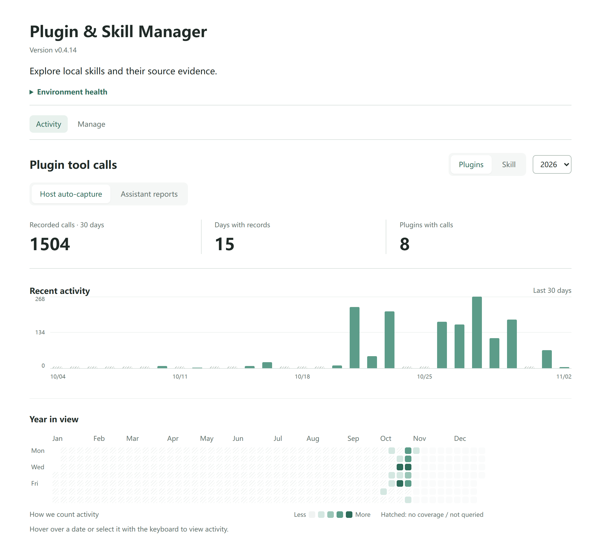
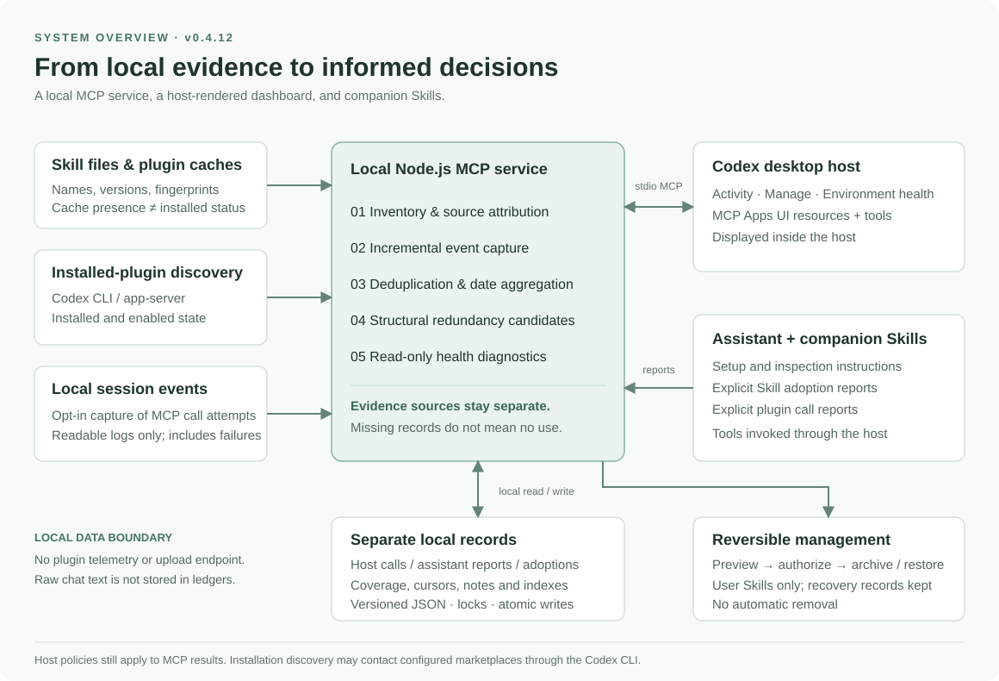

# Plugin & Skill Manager

[](https://github.com/zz11ss11zz/plugin-skill-manager/releases/latest) [](LICENSE) [](https://github.com/zz11ss11zz/plugin-skill-manager/stargazers)

**See which plugins and Skills are installed and used, identify redundancy, and streamline your tool environment for more efficient, controllable work.**

1. **Inventory your tools in one place**  
   Inspect plugin and Skill sources, versions, installation and enablement status. Spot duplicate installations, outdated versions and stale entries to reduce lookup and maintenance effort.

2. **Track usage to inform decisions**  
   Use cross-session records, time-based statistics and traceable sources to understand which tools are used frequently and which have had no records for a long time.

3. **Identify redundancy and support safe cleanup**  
   Consider overlapping functionality, duplicate installations, usage and your needs to identify plugins or Skills that could be uninstalled. You decide what to remove, reducing tool-selection noise, maintenance effort and unnecessary permissions. When cleanup reduces service startup, tool definitions or loaded instructions, it can improve runtime efficiency and reduce token consumption.

A local activity dashboard for Codex: calendar heatmaps, date-filtered rankings, and separate records for Skill adoptions and plugin call attempts.

**English** | [中文](README.zh-CN.md) · [Install](docs/DISTRIBUTION.md) · [Latest release](https://github.com/zz11ss11zz/plugin-skill-manager/releases/latest) · [Glama directory](https://glama.ai/mcp/servers/zz11ss11zz/plugin-skill-manager) · [Apache-2.0](LICENSE)



## What it helps you do

- Compare recorded activity in the last 30 days and over a year. Bars and calendar squares share a selected date; pinned daily rankings list names and counts. Back to all restores the period filters.
- Switch between Skill adoptions and plugin tool-call attempts without mixing the metrics.
- Filter period rankings by date independently of the pinned day, and distinguish missing coverage from zero activity.
- Inspect low-use candidates and items with no records in a compact observation panel. Open the counting details when needed; nothing is archived automatically.
- Review structural redundancy candidates in Manage: duplicate content, same-name instances and plugin-version candidates. Keep or defer items without treating a candidate as proof that removal is safe.
- Switch between Plugins and Skills in Manage. Plugin inventory counts unique IDs, supports installation-status filters and name/marketplace/version search, and distinguishes installed versions from cached Skill files. Installed plugins without Skills are included. Refresh rechecks installation status; failures retain the previous result and mark it stale.
- Click Personal skills, System skills, Skills in plugin cache, or Total in Manage to browse that category, then search within it. Counts represent Skill files, not plugins.
- Plugin installation status is checked automatically when entering Manage, with a one-minute cache and a retry action on failure. Save notes and preview reversible Windows user-skill archives and restores in the same view.
- The separate Setup page has been removed. The companion setup Skill and read-only recording diagnostic tool remain available in chat.

The complete product combines a **local MCP service, an activity UI, and two companion Skills** for setup and inspection. Installing a Skill alone does not install the service. Skill adoption recording requires caller participation. Plugin calls support opt-in local host-event capture; host events and assistant reports remain separate views. Local logs do not establish complete host-wide coverage. Missing records do not mean a Skill was never used.

## Architecture



The service reads Skill metadata and checks installed-plugin state through the Codex CLI. With automatic capture enabled, it incrementally extracts MCP call events from readable local session logs. Explicit adoption and call reports arrive through MCP tools. The service deduplicates records, aggregates them by date and source, and serves the Activity and Manage views through MCP Apps.

Versioned local JSON stores keep activity, coverage, notes and recovery metadata; raw conversations are not copied into the activity ledgers. Health checks are read-only, redundancy results are candidates, and user-Skill archive or restore actions use a preview and explicit authorization. MCP results are returned to the host under its policies; installation discovery may contact configured marketplaces. See [data flow](docs/PRIVACY.md) and [counting rules](docs/DATA_ACCURACY.md).

## Where it runs

**The current package targets local Codex use, including the Codex desktop app. It does not run directly in ChatGPT on the web.**

| Environment | Current project support |
| --- | --- |
| Codex desktop with a local executor | Intended UI host; Windows installation and MCP checks passed. Native sidebar interaction remains incompletely verified. |
| Codex CLI | Local installation, registration and MCP tools are tested; the CLI does not provide the graphical dashboard. |
| ChatGPT web / cloud execution | Not supported by this release. No hosted MCP endpoint or configured web bridge is included. |
| Other desktop hosts / operating systems | Not verified by this project. |

The service launches through local `stdio` using Node.js, reads local Codex files, and uses the Codex CLI for installed-plugin discovery. Signing in to the same account on the web does not connect these local resources. Browser screenshots and UI tests demonstrate the frontend, not a ChatGPT web deployment. Web support would require a supported remote connection or bridge plus explicit handling of local data access, authentication and permissions; changing the manifest alone is insufficient.

Platform references (checked 2026-10-29): [desktop-only plugins](https://developers.openai.com/plugins/deploy/desktop-only) and [MCP host/configuration boundaries](https://learn.chatgpt.com/docs/extend/mcp). These describe platform capabilities, not certification of this project.

## Quick start: complete manager

Tested on Windows. Requires Node.js 20.18+ and the Codex CLI on PATH. This is an independent project, not an official OpenAI product or an official-directory listing.

Download the [v0.5.0 complete plugin ZIP](https://github.com/zz11ss11zz/plugin-skill-manager/releases/download/v0.5.0/plugin-skill-manager-0.5.0-plugin.zip), verify its checksum on the release page, extract it to a permanent directory, and open PowerShell in the folder containing install.mjs:

```powershell
node install.mjs install
node install.mjs check
```

The check should show the installed 0.5.0 plugin with enabled set to true and a matching registered source. Reopen Codex, then ask it to open Plugin & Skill Manager or run the packaged setup Skill. The complete package includes the service, UI and both companion Skills. Keep the extracted folder in place; no npm install or build is required.

Version-specific regression and installation results are recorded in the validation log. Browser management checks passed; native-desktop interaction remains unverified. See [validation](docs/VALIDATION.md), [known limitations](docs/KNOWN_LIMITATIONS.md), and [upgrade/uninstall](docs/DISTRIBUTION.md). Developers can still [install from source](docs/LOCAL_SETUP.md).

## Official directory status

The **v0.5.0 desktop submission ZIP** is available separately on the release page. It contains the manifest and local MCP server at its root; use this for portal upload, not the installation ZIP. As of 2026-10-27, a **0.3.1 draft has been uploaded**, but it has not been submitted for review, approved, or published. At that check, the portal reported that it was not accepting more skills-only submissions. Recognition and eligibility for the bundled local MCP server remain unresolved. The GitHub release is available for manual installation; a saved portal draft is not an official listing.

## Optional: companion Skill

For third-party Skill directories, see the [bilingual listing kit](docs/distribution/THIRD_PARTY_LISTING.md), [dependency-aware installation guide](docs/distribution/THIRD_PARTY_INSTALL.md), and [verification status](docs/distribution/THIRD_PARTY_VALIDATION.md). Preparing these materials does not itself indicate a submitted or approved listing; see [channel status](docs/distribution/THIRD_PARTY_STATUS.md) for actual progress.

The complete plugin already includes these Skills. For the alternative source/MCP route, install the companion instructions from your downloaded source into your chosen project. The pinned skills CLI requires **Node.js 22.20+**, independently of the manager's Node requirement:

```powershell
# Run in the project where you want to use the Skill.
# Replace this path with your extracted source directory.
npx skills@1.7.4 add "C:\tools\plugin-skill-manager" --skill skill-manager --agent codex --copy
```

This local-source route was tested in an isolated project. On November 1, 2026, one remote GitHub installation through the official CLI succeeded using the existing local proxy, resolving the earlier clone failure for that check. The skills.sh detail page was available; search indexing remained unconfirmed. See [verification notes](docs/distribution/SKILLS_SH.md) and [companion Skill installation](docs/LOCAL_SETUP.md#配套-skill可选).

Start with: “Open Plugin & Skill Manager and explain the difference between adoption and call counts.” To collect new records, follow [adoption recording](docs/ADOPTION_RECORDING.md) or [plugin-call recording](docs/PLUGIN_CALLS.md). The companion Skill alone does not enable background collection.

Uninstall the complete plugin, preserving its local data:

```powershell
node install.mjs uninstall
```

## Environment health

The v0.5.0 source and complete plugin download share the same version. See the [v0.5.0 integration notes](docs/releases/v0.5.0.md). Includes **[Environment health](docs/ENVIRONMENT_HEALTH.md)**, grouped redundancy reports, installation-unit boundaries and packaged assessment principles. Functional-candidate retrieval still uses lexical/task clues and requires review; shared auxiliary steps alone do not establish redundancy. The screenshot above was captured with v0.4.14. See [validation](docs/VALIDATION.md) for verified behavior and limits.

## Demo and feedback

[Current demo and capture details](docs/media/README.md) · [Chinese README](README.zh-CN.md) · [Report an issue](https://github.com/zz11ss11zz/plugin-skill-manager/issues)

Useful feedback: installation steps that failed, confusing metric definitions, or missing workflows. Share sanitized errors and reproduction steps; omit private chats, paths and credentials.

## Evidence and Counting

| Signal | What it means |
| --- | --- |
| Skill adoption | The assistant explicitly records an adoption with `record_skill_use`. Repeated adoptions count separately. |
| Plugin tool call | An opted-in local host-event collector or an explicit caller records a tool-call attempt. Failed attempts count too. |
| Historical read request | A separate inferred signal; reading a Skill file can also mean review or audit. |
| Explicit mention | A separate historical intent signal, not proof of execution. |

Adoptions and plugin calls are separate metrics and are never added together. Skill adoptions are caller-reported; plugin calls can be collected from local host events after explicit opt-in. No records means unknown history, not never used. Enabling a recording tool does not backfill previous activity.

Retries reuse the same batch or call ID for deduplication. New adoptions remain separate even within one conversation. Skill counts use file instances; same-name copies retain their source identity. Ambiguous attribution is not distributed across instances.

Daily totals use the full index rather than the limited evidence list. Rankings use the intersection of the selected dates and recorded coverage. With automatic capture disabled, refresh reads existing statistics only. When explicitly enabled, local polling and visible-panel refresh honor the shared collection interval; coverage remains limited to readable local host events.

## Privacy

Runtime records are stored locally under `$CODEX_HOME/skill-manager/data-v1` (default `~/.codex/skill-manager/data-v1`); archives are separately kept under `$CODEX_HOME/skill-manager-archive`. The application adds no telemetry or upload endpoint, but MCP tool results are returned to the host and may be used in its model context under the host's policies. Plugin-installation checks, including automatic checks on entering Manage, may contact configured marketplaces. See [privacy and data flow](docs/PRIVACY.md), [project terms](docs/TERMS.md), [support](docs/SUPPORT.md), and [migration](docs/DATA_MIGRATION.md).

The repository contains code, documentation and synthetic test fixtures. The current English README image shows explicitly selected, sanitized real aggregate activity from the maintainer. It contains dates and counts, not chat text, tool arguments, session identifiers, credentials or local file paths. Historical demo images remain labeled as synthetic.

## Development

See [architecture](docs/dev/ARCHITECTURE.md), [configuration](docs/dev/CONFIGURATION.md) and [dependency management](docs/dev/DEPENDENCIES.md). `pnpm run verify` runs contract, architecture and type checks plus the full test suite.

`pnpm test` builds the UI and runs unit and stdio MCP integration tests with synthetic temporary directories. UI resources use content-hashed URLs; retained revisions let open panels request their matching version. Do not remove revisions while older panels remain open.

The frontend uses the MCP Apps SDK; backend tools use MCP SDK v1. Dependency versions are pinned. No Python runtime is required.

`pnpm run build:marketplace` now creates a self-contained development catalog with the runtime package and companion Skill. See [marketplace setup and the resolved Windows installation issue](docs/MARKETPLACE.md). This is not yet a verified remote GitHub marketplace or published npm package. Protocol and synthetic UI tests do not establish native-sidebar acceptance.

## License

Copyright 2026 Zishen Wang. Licensed under [Apache-2.0](LICENSE); see [NOTICE](NOTICE). Dependencies retain their own licenses. Generated standalone packages include third-party license texts.
