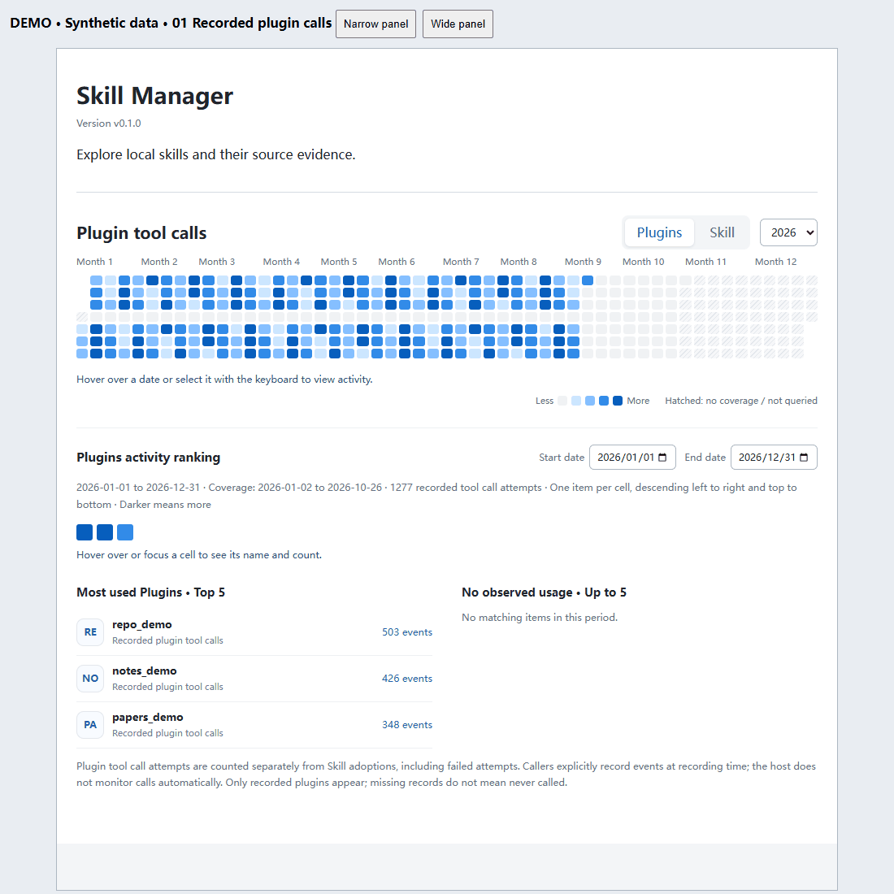

# Codex Skill Manager

**See which Skills were recorded as adopted, and which plugins were recorded as called.**

A local activity dashboard for Codex: calendar heatmaps, date-filtered rankings, and separate records for Skill adoptions and plugin call attempts.

**English** | [中文](README.zh-CN.md) · [Install](docs/LOCAL_SETUP.md) · [Release v0.1.1](https://github.com/zz11ss11zz/codex-skill-manager/releases/tag/v0.1.1) · [Apache-2.0](LICENSE)



*Actual dashboard UI in a browser demonstration host, using synthetic records. This is not a native Codex recording or real user activity. [Static screenshot](docs/media/en/dashboard-skills.png) · [Demo provenance](docs/media/README.md). The demo includes localization corrections made after v0.1.0.*

## What it helps you do

- See recorded activity over a year and inspect individual dates.
- Switch between Skill adoptions and plugin tool-call attempts without mixing the metrics.
- Filter rankings by date and distinguish missing coverage from zero activity.
- Ask the connected MCP tools about local inventory, notes, duplicate candidates, or reversible Windows user-skill archives. These management controls are not currently in the dashboard.

The complete product combines a **local MCP service, an activity UI, and a companion Skill**. Installing the Skill alone does not install the service. Recording requires explicit caller participation; this is not an automatic host monitor. Missing records do not mean a Skill was never used.

## Quick start: complete manager

Tested on Windows. Requires Node.js 20.18+ and the Codex CLI on PATH. This is an independent project, not an official OpenAI product or an official-directory listing.

Download the [v0.1.0 source ZIP](https://github.com/zz11ss11zz/codex-skill-manager/archive/refs/tags/v0.1.1.zip), extract it to a permanent directory, and open PowerShell in the folder containing package.json:

```powershell
npm.cmd ci --ignore-scripts
npm.cmd test
npm.cmd run setup:install
npm.cmd run setup:check
```

The check should report registered, matches, and enabled as true. Reload the MCP service or reopen Codex, then ask it to call `open_skill_manager`. Keep the source directory in place. `npm start` runs a stdio service; it does not open a browser.

The source-install path has passed 55 regression tests and six isolated service lifecycle checks. Native-sidebar interaction in the latest desktop host remains unverified. See [validation](docs/VALIDATION.md), [known limitations](docs/KNOWN_LIMITATIONS.md), and [setup/recovery](docs/LOCAL_SETUP.md).

## Optional: companion Skill

After setting up the service, install the companion instructions from your downloaded source into your chosen project. The pinned skills CLI requires **Node.js 22.20+**, independently of the manager's Node requirement:

```powershell
# Run in the project where you want to use the Skill.
# Replace this path with your extracted source directory.
npx skills@1.7.4 add "C:\tools\codex-skill-manager" --skill skill-manager --agent codex --copy
```

This local-source route was tested in an isolated project. A direct GitHub route is available in the CLI, but our network test failed during Git clone; do not treat it as verified here. See [companion Skill installation](docs/LOCAL_SETUP.md#配套-skill可选).

Start with: “Open Skill Manager and explain the difference between adoption and call counts.” To collect new records, follow [adoption recording](docs/ADOPTION_RECORDING.md) or [plugin-call recording](docs/PLUGIN_CALLS.md). The companion Skill alone does not enable background collection.

Unregister the service, preserving its local data:

```powershell
npm.cmd run setup:uninstall
```

## Demo and feedback

[Chinese launch copy and 30-second script](docs/LAUNCH.zh-CN.md) · [Reproduce the synthetic demo](docs/media/README.md) · [Report an issue](https://github.com/zz11ss11zz/codex-skill-manager/issues)

Useful feedback: installation steps that failed, confusing metric definitions, or missing workflows. Share sanitized errors and reproduction steps; omit private chats, paths and credentials.

## Language

The dashboard uses the MCP Apps host context `locale`: Chinese locales display Chinese; English locales display English. Host locale updates refresh labels without resetting the selected year, dates, or activity type. Tooltips, empty states, error messages, and accessibility labels are localized too. Skill names, paths, and source data retain their original text.

When the host supplies no locale, the browser language is used initially. Unsupported languages fall back to English. Actual propagation of a changed Codex language setting depends on the host; if it sends no update, reopen the panel. Live Codex language-switch acceptance remains to be verified.

## Evidence and Counting

| Signal | What it means |
| --- | --- |
| Skill adoption | The assistant explicitly records an adoption with `record_skill_use`. Repeated adoptions count separately. |
| Plugin tool call | A caller records an attempted tool call with `record_plugin_calls`. Failed attempts count too. |
| Historical read request | A separate inferred signal; reading a Skill file can also mean review or audit. |
| Explicit mention | A separate historical intent signal, not proof of execution. |

Adoptions and plugin calls are separate metrics and are never added together. Recording is opt-in caller behavior, not automatic host monitoring. No records means unknown history, not never used. Enabling a recording tool does not backfill previous activity.

Retries reuse the same batch or call ID for deduplication. New adoptions remain separate even within one conversation. Skill counts use file instances; same-name copies retain their source identity. Ambiguous attribution is not distributed across instances.

Daily totals use the full index rather than the limited evidence list. Rankings use the intersection of the selected dates and recorded coverage. A refresh reads existing statistics; it does not import new chat logs or poll on a timer.

Recording details: [Skill adoptions (Chinese)](docs/ADOPTION_RECORDING.md) · [Plugin calls (Chinese)](docs/PLUGIN_CALLS.md).

## Privacy

Runtime records stay on the local machine under `$CODEX_HOME/skill-manager/data-v1` (default `~/.codex/skill-manager/data-v1`); see [migration and rollback](docs/DATA_MIGRATION.md). The application adds no telemetry, uploads, or external model service. Statistical indexes retain required references and timestamps, not full chat transcripts. Explicit plugin-installation verification can invoke `codex plugin list --json`, which may contact configured marketplaces.

The repository contains code, documentation, and synthetic test data. README badges load from Shields.io when viewing this page; they are not part of the dashboard.

## Development

`npm test` builds the UI and runs unit and stdio MCP integration tests with synthetic temporary directories. UI resources use content-hashed URLs; retained revisions let open panels request their matching version. Do not remove revisions while older panels remain open.

The frontend uses the MCP Apps SDK; backend tools use MCP SDK v1. Dependency versions are pinned. No Python runtime is required.

`npm run build:marketplace` now creates a self-contained development catalog with the runtime package and companion Skill. See [marketplace setup and the resolved Windows installation issue](docs/MARKETPLACE.md). This is not yet a verified remote GitHub marketplace or published npm package. Protocol and synthetic UI tests do not establish native-sidebar acceptance.

Further project records (Chinese): [Roadmap](docs/ROADMAP.md) · [Validation](docs/VALIDATION.md) · [Complete Chinese documentation](README.zh-CN.md).

## License

Copyright 2026 Zishen Wang. Licensed under [Apache-2.0](LICENSE); see [NOTICE](NOTICE). Dependencies retain their own licenses. Generated standalone packages include third-party license texts.
