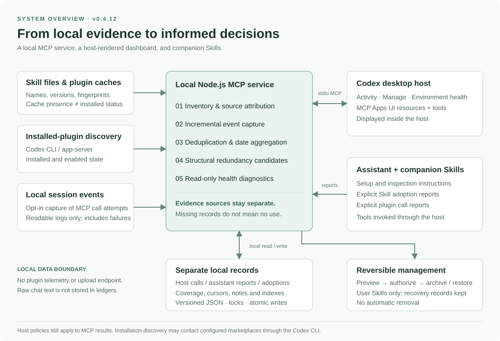

# Plugin & Skill Manager

[](https://github.com/zz11ss11zz/plugin-skill-manager/releases/latest) [](LICENSE) [](https://github.com/zz11ss11zz/plugin-skill-manager/stargazers)

**看清插件和 Skill 的安装与使用情况，识别冗余，帮助用户精简工具环境，让日常工作更高效、更可控。**

1. **统一盘点，掌握工具环境**  
   集中查看 Skill 和插件的来源、版本、安装及启用状态，发现重复安装、旧版本和失效项目，减少查找与维护成本。

2. **记录使用，为管理提供依据**  
   通过跨会话使用记录、时间统计和来源追溯，了解哪些工具经常使用、哪些长期没有记录。

3. **识别冗余，辅助安全清理**  
   综合功能重叠、重复安装、使用情况和用户需求，找出可以卸载的插件或 Skill。由用户决定后清理，减少工具选择干扰、维护负担和不必要的权限；在减少服务启动、工具定义或指令加载时，可提高运行效率并降低 token 消耗。

面向 Codex 的本地活动面板：查看日期热力图和按时间筛选的排名，分别记录 Skill 采用与插件工具调用尝试。

[English](README.md) | **中文** · [下载安装](docs/DISTRIBUTION.md) · [最新 Release](https://github.com/zz11ss11zz/plugin-skill-manager/releases/latest) · [Glama 目录](https://glama.ai/mcp/servers/zz11ss11zz/plugin-skill-manager) · [Apache-2.0](LICENSE)


## 能帮你做什么

- 查看近 30 天与全年已记录活动；柱图和日历格子共享选中日期，固定日期后显示当天的名称与次数排名，“返回全部”恢复区间筛选。
- 在 Skill 采用与插件工具调用尝试之间切换，避免混算。
- 独立筛选区间排名，不与固定的单日混淆；区分没有覆盖和已记录为零。
- 在精简的观察区查看低频候选与无记录项目，需要时展开统计说明；不会自动归档。
- 在管理页查看结构性冗余候选，包括重复内容、同名实例和插件版本候选。可以保留或暂缓处理；候选不代表已经确认可以安全删除。
- 管理页可切换“插件／技能”。插件清单按唯一 ID 计数，支持安装状态筛选和名称／市场／版本搜索，分别显示安装版本与缓存 Skill 文件；没有 Skill 的已安装插件也会列出。刷新会重新核验安装状态，失败时保留旧结果并标明过期。
- 点击管理页的个人技能、系统技能、插件缓存中的技能或合计，查看对应列表并在分类内搜索；数量按 Skill 文件计，不是插件数。
- 进入管理页自动核对插件安装状态，结果缓存一分钟，失败时提供重试；可在同一页面保存备注，预览 Windows 用户技能的可逆归档与恢复。
- 已移除独立“接入”页；配套 setup Skill 和只读记录诊断工具仍可在聊天中使用。

完整产品由 **本地 MCP 服务、活动界面和两个配套 Skill** 组成，分别支持接入与检查。单独安装 Skill 不会安装服务。Skill 采用需要调用方主动记录；插件调用支持明确启用后的本机宿主事件采集，宿主事件与助手上报分开展示。本机日志不代表所有宿主活动的完整覆盖；没有记录不等于从未使用。

## 架构



服务读取 Skill 元数据，通过 Codex CLI 核对已安装插件状态。启用自动采集后，从可读的本机会话日志中增量提取 MCP 调用事件；显式的采用记录与调用上报通过 MCP 工具写入。服务对记录去重，按日期和来源汇总，再通过 MCP Apps 提供“活动”和“管理”界面。

带版本的本地 JSON 存储保存活动、覆盖范围、备注和恢复元数据，不将原始对话复制到活动台账。环境检查只读，冗余结果仅为候选；用户 Skill 的归档与恢复需要预览和明确授权。MCP 结果按宿主政策返回宿主；安装状态查询可能访问已配置的市场。详见[数据流](docs/PRIVACY.md)和[统计规则](docs/DATA_ACCURACY.md)。

## 适用平台

**当前发布包面向本地 Codex 使用（包括 Codex 桌面端），不能直接在 ChatGPT 网页端运行。**

| 环境 | 本项目当前支持情况 |
| --- | --- |
| Codex 桌面端，本地执行 | 图形界面的目标宿主；Windows 安装与 MCP 检查已通过，原生侧栏交互尚未完整验证 |
| Codex CLI | 已验证本地安装、注册及 MCP 工具；命令行不提供图形活动面板 |
| ChatGPT 网页端／云端执行 | 本版不支持；未提供托管 MCP 地址或已配置的网页桥接服务 |
| 其他桌面宿主／操作系统 | 本项目尚未验证 |

服务通过本机 Node.js 以 `stdio` 启动，读取本地 Codex 文件，并调用 Codex CLI 查询已安装插件。同一账号登录网页端不会自动连接这些本机资源。浏览器截图与界面测试仅验证前端，不代表已部署到 ChatGPT 网页端。网页端支持需要受支持的远程连接或桥接方案，并明确本机数据访问、认证及权限；只改 manifest 不足以实现。

平台依据（2026-10-29 核对）：[仅桌面端插件](https://developers.openai.com/plugins/deploy/desktop-only)、[MCP 宿主与配置边界](https://learn.chatgpt.com/docs/extend/mcp)。这些说明平台能力，不代表本项目已获官方认证。

## 安装完整管理器

已验证环境为 Windows，需要 Node.js 20.18+ 和 PATH 中可用的 Codex CLI。本项目为独立开源项目，不是 OpenAI 官方产品，尚未上架官方插件目录。

下载 [v0.5.0 完整插件 ZIP](https://github.com/zz11ss11zz/plugin-skill-manager/releases/download/v0.5.0/plugin-skill-manager-0.5.0-plugin.zip)，核对 Release 中的校验值，解压到固定目录。在含 `install.mjs` 的目录打开 PowerShell：

```powershell
node install.mjs install
node install.mjs check
```

检查结果应显示已安装并启用的 0.5.0 插件，且注册来源匹配。重开 Codex，再让助手打开 Plugin & Skill Manager 或运行本插件的 setup Skill。包内已经包含服务、界面与两个配套 Skill，无需 npm 安装或构建；保留解压目录。

各版本回归与安装结果见验收记录。浏览器管理交互通过；原生桌面交互仍未完整验证。详见[验收记录](docs/VALIDATION.md)、[已知限制](docs/KNOWN_LIMITATIONS.md)和[升级与卸载](docs/DISTRIBUTION.md)。开发者仍可选择[源码安装](docs/LOCAL_SETUP.md)。

## 官方目录状态

Release 页另提供 **v0.5.0 桌面提交 ZIP**，根目录包含 manifest 与本地 MCP 服务。门户上传请使用该包，不要上传带安装器的完整安装 ZIP。

截至 2026-10-27，**0.3.1 草稿已上传**，尚未提交审核、获批或发布。当时门户提示暂不接受更多 skills-only 提交，本地 MCP 服务的识别与准入仍待确认。GitHub 发布包可手动安装；保存草稿不等于官方上架。

## 安装配套 Skill（可选）

第三方 Skill 目录的[中英文收录材料](docs/distribution/THIRD_PARTY_LISTING.md)、[依赖与安装说明](docs/distribution/THIRD_PARTY_INSTALL.md)及[验证状态](docs/distribution/THIRD_PARTY_VALIDATION.md)已单独整理。材料准备本身不代表已提交或获得收录；各渠道实际进展见[渠道状态](docs/distribution/THIRD_PARTY_STATUS.md)。

完整插件已包含配套 Skill，无需重复安装。本节适用于替代的源码/MCP 安装路径：将下载源码中的配套指令安装到希望使用的项目。固定版本的 skills CLI 需要 **Node.js 22.20+**，独立于管理器自身的 Node 要求：

```powershell
# 在希望使用该 Skill 的项目目录运行。
# 将路径替换为实际解压的源码目录。
npx skills@1.7.4 add "C:\tools\plugin-skill-manager" --skill skill-manager --agent codex --copy
```

本地源码安装路径已在隔离项目中验证。2026-11-01，经现有本地代理完成了一次官方 CLI 的远程 GitHub 安装；此前克隆失败的网络问题已在该次验证中解决。skills.sh 详情页可访问，搜索收录仍待确认。详见[验证记录](docs/distribution/SKILLS_SH.md)及[配套 Skill 安装](docs/LOCAL_SETUP.md#配套-skill可选)。

可以对助手说：“打开 Plugin & Skill Manager，解释采用次数和插件调用次数有什么区别。”要记录后续活动，按[采用记录说明](docs/ADOPTION_RECORDING.md)或[插件调用接入](docs/PLUGIN_CALLS.md)配置明确约定。单独安装配套 Skill 不会开启后台采集。

卸载完整插件并保留本地数据：

```powershell
node install.mjs uninstall
```

## 环境诊断

已发布的 v0.5.0 包包含 **[统一环境诊断](docs/ENVIRONMENT_HEALTH.md)**：可在界面手动检查依赖、安装、数据和采集状态；也可独立运行 `node scripts/doctor.mjs`，中文输出使用 `--zh`。单项失败仍返回其余结果并提供处理建议。

上方截图为 v0.4.14 中文界面（不作为最新版的原生桌面验证）。本仓库源码已更新为 [v0.5.0](docs/releases/v0.5.0.md)，上方 GitHub 下载链接对应 v0.5.0。具体功能及原生桌面验收边界以[验收记录](docs/VALIDATION.md)为准。

## 演示与反馈

[演示与截图说明](docs/media/README.md) · [English README](README.md) · [反馈问题](https://github.com/zz11ss11zz/plugin-skill-manager/issues)

欢迎反馈安装失败步骤、难以理解的统计口径或缺少的工作流程。请提供脱敏错误和复现步骤，不要上传真实聊天、工具凭据或未脱敏的本机路径。

## 证据与统计口径

| 记录 | 表示什么 |
| --- | --- |
| Skill 采用 | 助手通过 `record_skill_use` 显式记录；重复采用分别计数 |
| 插件工具调用 | 明确启用的本机宿主事件采集或调用方显式上报的调用尝试；失败也计入 |
| 历史读取请求 | 独立的推断信号；读取 Skill 文件也可能只是审阅或审计 |
| 显式提及 | 独立的历史意图信号，不能证明实际执行 |

采用与插件调用是独立指标，不相加。Skill 采用由调用方报告；插件调用可在明确启用后从本地宿主事件中采集。没有记录表示历史未知，不等于从未使用。启用记录工具不会补造此前活动。

重试沿用相同的批次或调用 ID 去重；同一对话中的新采用仍分别计数。Skill 按文件实例统计，同名副本保留来源身份。归属不明的记录不会分摊给各实例。

每日总量使用完整索引，不受有限证据列表长度影响。排名按所选日期与已记录覆盖范围的交集统计。关闭自动采集时，刷新只读取已有统计；明确启用后，本地轮询和可见面板刷新遵守共享采集间隔，覆盖仍仅限可读的本地宿主事件。

## 隐私

运行记录保存在 `$CODEX_HOME/skill-manager/data-v1`，默认位置为 `~/.codex/skill-manager/data-v1`；归档另存于 `$CODEX_HOME/skill-manager-archive`。应用自身没有遥测或上传接口，但 MCP 工具结果会返回宿主，可能按宿主政策用于模型上下文。插件安装检查，包括进入管理页时的自动检查，可能访问配置的市场。详见[隐私与数据流](docs/PRIVACY.md)、[项目条款](docs/TERMS.md)、[支持](docs/SUPPORT.md)和[数据迁移](docs/DATA_MIGRATION.md)。

仓库包含代码、文档和合成测试数据。当前 README 图片使用维护者明确选取、脱敏后的真实汇总活动，包含日期和次数，不包含聊天正文、工具参数、会话标识、凭据或本地文件路径。历史演示图片仍标明使用合成数据。

## 开发

架构、配置与依赖管理见 [docs/dev/ARCHITECTURE.md](docs/dev/ARCHITECTURE.md)、[CONFIGURATION.md](docs/dev/CONFIGURATION.md)、[DEPENDENCIES.md](docs/dev/DEPENDENCIES.md)。`pnpm run verify` 运行契约、架构、类型检查和全部测试。

`pnpm test` 构建 UI，并使用合成临时目录运行单元测试和 stdio MCP 集成测试。界面资源使用内容哈希 URL；保留的历史版本可供已打开的面板请求匹配内容。旧面板仍打开时，不要删除对应资源版本。

前端使用 MCP Apps SDK，后端工具使用 MCP SDK v1；依赖版本固定，无需 Python 运行时。

`pnpm run build:marketplace` 生成包含运行包与配套 Skill 的自包含开发目录。详见[市场配置与已解决的 Windows 安装问题](docs/MARKETPLACE.zh-CN.md)。这不代表已验证远程 GitHub marketplace 或已发布 npm 包；协议与合成界面测试也不等于原生侧栏验收。

## 许可证

Copyright 2026 Zishen Wang。采用 [Apache-2.0](LICENSE)，见 [NOTICE](NOTICE)。依赖保留各自许可证；生成的独立运行包包含第三方许可证文本。
