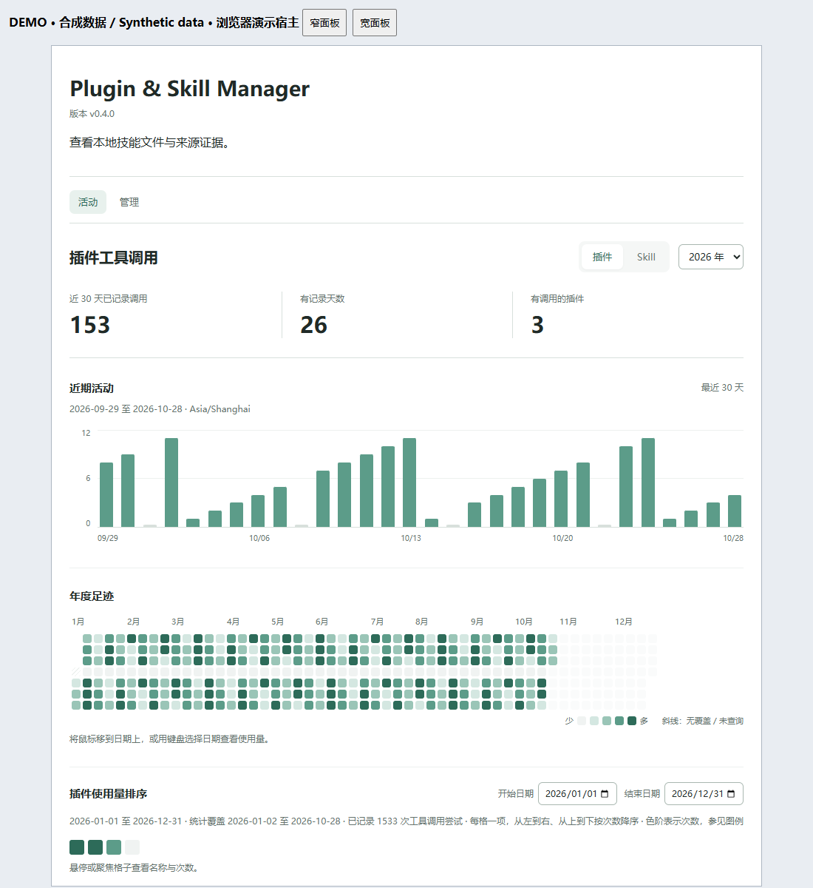

[English](README.md) | **中文**

# Plugin & Skill Manager

**看清插件和 Skill 的安装与使用情况，识别冗余，帮助用户精简工具环境，让日常工作更高效、更可控。**

1. **统一盘点，掌握工具环境**  
   集中查看 Skill 和插件的来源、版本、安装及启用状态，发现重复安装、旧版本和失效项目，减少查找与维护成本。

2. **记录使用，为管理提供依据**  
   通过跨会话使用记录、时间统计和来源追溯，了解哪些工具经常使用、哪些长期没有记录。

3. **识别冗余，辅助安全清理**  
   综合功能重叠、重复安装、使用情况和用户需求，找出可以卸载的插件或 Skill。由用户决定后清理，减少工具选择干扰、维护负担和不必要的权限；在减少服务启动、工具定义或指令加载时，可提高运行效率并降低 token 消耗。

查看日期热力图、按时间筛选排名，分别理解 Skill 采用与插件调用尝试。记录保存在本机。

[下载安装](docs/DISTRIBUTION.md) · [v0.4.6](https://github.com/zz11ss11zz/plugin-skill-manager/releases/tag/v0.4.6) · [Apache-2.0](LICENSE) · [反馈问题](https://github.com/zz11ss11zz/plugin-skill-manager/issues)



上图为 v0.4.0 实际浏览器截图，使用合成记录；包含活动／管理双页、每日柱图、年度格子与已记录统计，不是原生 Codex 截图。[验证与复现说明](docs/releases/v0.4.0.md)。

## 能帮你做什么

- 查看近 30 天与全年已记录活动；柱子和格子共享选中日期，点击显示当天完整的名称与次数排名，“返回全部”恢复区间筛选。
- 在插件调用与 Skill 采用之间切换，避免混算。
- 独立筛选区间排名，不与固定的单日混淆；区分没有覆盖和已记录为零。
- 在精简的观察区查看低频候选与无记录项目，需要时展开统计说明；不会自动归档。
- 点击管理页的个人技能、系统技能、插件缓存中的技能或合计，查看对应列表并在分类内搜索；数量按 Skill 文件计，不是插件数。
- 进入管理页自动核对插件安装状态，结果缓存一分钟，失败时提供重试；仍可保存备注，预览并执行 Windows 用户技能的可逆归档与恢复。
- 已移除独立“接入”页；配套 setup Skill 和只读记录诊断工具仍可在聊天中使用。

完整产品由 **本地 MCP 服务＋活动界面＋配套 Skill** 组成。单独安装 Skill 不会安装服务；Skill 采用仍需助手主动记录；v0.4.0 中插件调用可明确启用本机日志自动采集，未启用时仍依赖调用方上报。本机日志覆盖不等于所有宿主活动的完整覆盖，不会补造采用历史。

## 适用平台

**当前发布包面向本地 Codex 使用（包括 Codex 桌面端），不能直接在 ChatGPT 网页端运行。**

| 环境 | 本项目当前支持情况 |
| --- | --- |
| Codex 桌面端，本地执行 | 图形界面的目标宿主；Windows 安装与 MCP 检查已通过，原生侧栏交互尚未完整验证 |
| Codex CLI | 已验证本地安装、注册及 MCP 工具；命令行不提供图形活动面板 |
| ChatGPT 网页端／云端执行 | 本版不支持；未提供托管 MCP 地址或已配置的网页桥接服务 |
| 其他桌面宿主／操作系统 | 本项目尚未验证 |

服务通过本机 Node.js 以 `stdio` 启动，读取本地 Codex 文件，并调用 Codex CLI 查询已安装插件。同一账号登录网页端不会自动连接这些本机资源。README 中的浏览器截图与界面测试仅验证前端，不代表已部署到 ChatGPT 网页端。若要支持网页端，需要受支持的远程连接或桥接方案，并明确本机数据访问、认证及权限；只改 manifest 不足以实现。

平台依据（2026-10-29 核对）：[仅桌面端插件](https://developers.openai.com/plugins/deploy/desktop-only)、[MCP 宿主与配置边界](https://learn.chatgpt.com/docs/extend/mcp)。这些说明平台能力，不代表本项目已获官方认证。

## 安装完整管理器

已验证环境为 Windows，需要 Node.js 20.18+ 和 PATH 中可用的 Codex CLI。本项目为独立开源项目，不是 OpenAI 官方产品，尚未上架官方插件目录。

下载 [v0.4.6 完整插件 ZIP](https://github.com/zz11ss11zz/plugin-skill-manager/releases/download/v0.4.6/plugin-skill-manager-0.4.6-plugin.zip)，核对 Release 中的校验值，解压到固定目录。在含 install.mjs 的目录打开 PowerShell：

```powershell
node install.mjs install
node install.mjs check
```

检查结果应显示已安装并启用的 0.4.6 插件，且注册来源匹配。重开 Codex，再让助手打开Plugin & Skill Manager或运行本插件的 setup Skill。包内已经包含服务、界面与两个配套 Skill，无需 npm 安装或构建；保留解压目录。

本版回归和隔离安装升级结果见验收记录。浏览器管理交互通过；最新版桌面原生侧栏仍未验证。详见 [升级与卸载](docs/DISTRIBUTION.md)、[验收记录](docs/VALIDATION.md) 和 [已知限制](docs/KNOWN_LIMITATIONS.md)。开发者仍可选择[源码安装](docs/LOCAL_SETUP.md)。

## 官方目录状态

本次提供独立的 **v0.4.6 desktop-package.zip 提交包**，根目录包含 manifest 与本地 MCP 服务。门户上传请使用该包，不要上传带安装器的 plugin.zip。

截至 2026-10-27，**0.3.1 草稿已上传**，尚未提交审核、获批或发布。门户当前提示暂不接受更多 skills-only 提交，本地 MCP 服务的识别与准入仍待确认。GitHub 发布包可手动安装；保存草稿不等于官方上架。

## 安装配套 Skill（可选）

完整插件已包含配套 Skill，无需重复安装。本节仅适用于源码/MCP 安装路径；配套 Skill 提供查询和解释记录的操作约定，不会自动开启后台采集。

固定版本的 skills CLI 需要 **Node.js 22.20+**，高于管理器自身要求。进入希望使用该 Skill 的项目目录，替换下方路径为实际解压的源码目录：

```powershell
npx skills@1.7.4 add "C:\tools\plugin-skill-manager" --skill skill-manager --agent codex --copy
```

本地源码安装路径已在隔离项目中实际通过。远程 GitHub 命令本次在克隆阶段连接重置，没有记为通过。[完整步骤与远程可选方式](docs/LOCAL_SETUP.md#配套-skill可选)。

安装后可对助手说：“打开Plugin & Skill Manager，解释采用次数和插件调用次数有什么区别。”要记录后续活动，按 [采用记录说明](docs/ADOPTION_RECORDING.md) 或 [插件调用接入](docs/PLUGIN_CALLS.md) 配置明确约定。

## 怎样理解数字

| 记录 | 表示什么 |
| --- | --- |
| Skill 采用 | 助手显式调用 record_skill_use 写入；重复采用分别计数 |
| 插件调用 | 明确启用的本机宿主事件采集或调用方上报的尝试次数，失败也计入 |
| 历史读取或提及 | 独立参考信号，不能直接当作实际采用 |
| 未记录／无覆盖 | 历史未知，不等于从未使用 |

Skill 按文件实例统计，同名副本保留身份。相同批次或调用 ID 重试去重；不同采用不按对话合并。未启用自动采集时，刷新只读取现有统计；启用后，后台与面板遵守共享采集间隔，覆盖仅限本机可读的真实宿主事件。import_usage 仍用于显式导入历史 Skill 推断信号。

## 本地数据与卸载

记录与备注默认位于 CODEX_HOME 下的 skill-manager/data-v1，归档另存于 skill-manager-archive。应用自身没有遥测或上传接口，但 MCP 工具结果会交给宿主，可能按宿主政策用于模型上下文。插件状态检查（包括进入管理页时的自动检查）可能访问配置的市场。详见[隐私与数据流](docs/PRIVACY.md)、[项目使用说明](docs/TERMS.md)和[支持](docs/SUPPORT.md)。

```powershell
node install.mjs uninstall
```

完整包卸载脚本只移除本插件及专属市场注册，保留本地数据和归档。[升级、备份与恢复](docs/DATA_MIGRATION.md)。源码安装则仍用 `npm.cmd run setup:uninstall` 移除独立 MCP 注册。

## 演示、反馈和开发

[中文发布文案与字幕](docs/LAUNCH.zh-CN.md) · [复现演示](docs/media/README.md) · [开发路线](docs/ROADMAP.md) · [完整验收记录](docs/VALIDATION.md)

欢迎在 Issues 提供脱敏错误、复现步骤与统计口径建议。不要上传真实聊天、凭据或未脱敏的本机路径。

`npm test` 构建 UI 并运行合成数据测试；`npm run build:marketplace` 生成本地开发市场包，不代表远程市场或官方目录已经上架。[市场开发说明](docs/MARKETPLACE.zh-CN.md)。

Copyright 2026 Zishen Wang。采用 [Apache-2.0](LICENSE)，见 [NOTICE](NOTICE)；依赖保留各自许可证。


管理页现在提供「插件／技能」切换。插件清单按唯一 ID 计数，支持安装状态筛选、名称/市场/版本搜索，以及安装版本和缓存 Skill 文件的分别查看；无 Skill 的已安装插件也会列出。刷新插件清单会重新核验安装状态，失败保留旧结果并提示过期。
